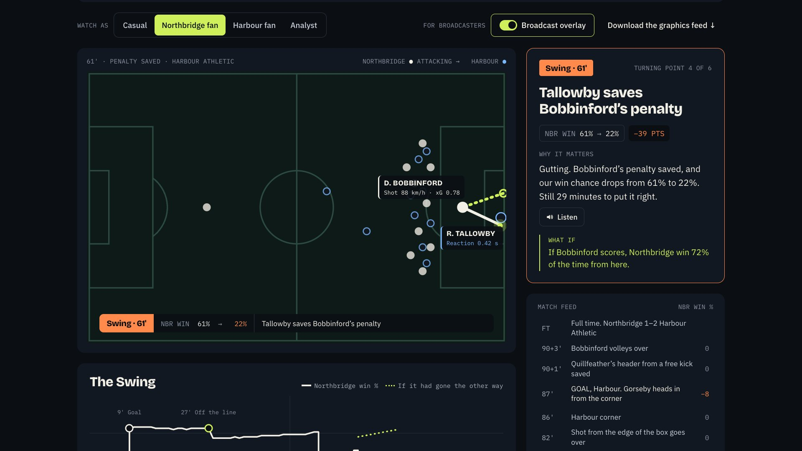

# what if?

**Same match. Different ending.**



what if? takes a football match as it happens and asks what else could have happened. It finds the
moments that changed the result, replays the ones that nearly did, and plays the rest of the season
out 10,000 times to show who else the result moved. A team of agents on Microsoft Foundry decides
what to test, runs the simulation engine as its toolbox, and explains what it found, for a casual
fan, a club's fan or an analyst, in seven languages across the whole site. Every number comes from
the engine; every sentence is checked by a Verifier before anyone sees it.

- **Live:** https://icy-rock-0e0b6b300.4.azurestaticapps.net
- **Demo video (under 2 minutes):** *added at submission*
- **Category:** Best Multi-Agent Orchestration

Everything is synthetic: 20 invented clubs, 500 invented players, a 380-game season. No real club,
player, competition or mark appears anywhere in the data, the interface or this repository (a test
checks every file).

## The pitch

Football coverage reports what happened. It rarely explains why a moment mattered, what would have
happened otherwise, or what a result means for everyone else, and when AI tries, it makes numbers
up. what if? fixes both: a seeded simulation engine produces every number, and specialised agents
turn those numbers into explanations that are checked against them before they're shown.

Who it's for: **broadcasters** (Settle It answers a pundit's question on air with a test, an on-air
graphic and a presenter script; the overlay cue feed drives graphics), **fans** (the same match told
from your side, in your language, with alerts that matter to you), and **analysts** (exact win
probability, xG replays, fair credit for every moment, ranges on every season chance).

**Microsoft technology:** Microsoft Foundry (the agents' model), Azure Static Web Apps with Azure
Functions (site and agent API on one origin), Azure Cosmos DB (the league database and agent run
log), Application Insights (one structured log line per agent run), an MCP server (the engine as
tools for GitHub Copilot agent mode or any agent), Azure AI Speech (every explanation read aloud in
the reader's language, questions asked by voice, and the demo's narration), and GitHub Actions with
GitHub's identity-based deploys.

## Try it in 60 seconds

1. **Home → Ask What If.** Type any question ("Did Northbridge deserve to win?", "What would it take
   for Harbour to stay up?"). The router hands it to the team that can answer, and the destination
   shows who handed it over.
2. **The Swing.** Play the flagship match. Win probability moves with every event; each turning point
   gets a card, a what-if and an on-pitch overlay. *For broadcasters → Download the graphics feed* gives the timed cue feed for a graphics system.
3. **Settle It.** Ask the studio question. Open *How the agents worked it out* to see the real
   trace: the Data Scientist's tool calls, the facts, the Narrator's drafts, the Verifier's checks.
4. **Ripple** at full time: the automated recap, the impact reel, and what the result does to every
   club's season.
5. **Current Affairs:** the table with every club's chances; tap a club, then a player.
6. **Listen and speak.** *Listen* reads a Swing card, a Ghost Run verdict, the presenter script, the
   recap or a Multiverse story aloud in a neural voice; the mic in the Ask box and Settle It takes the
   question by voice.
7. **Language** (top right, or My Dugout): pick 中文, Melayu, தமிழ், हिन्दी, Español or Português.
   Menus switch at once; every other line is translated by the Narrator and only replaces the
   English once the Verifier has checked it carries the same numbers.
8. **My Dugout:** switch club or depth and watch every screen, and the Scout's alerts, follow.

## How it meets the judging criteria

| Criterion | Where to see it |
| --- | --- |
| **Technological implementation** | A deterministic synthetic league (`forge/`, reproducible to the byte); an engine that computes live win probability exactly over every scoreline (`src/engine/match.ts`); 110+ tests, including 1,000+ generated cards through the Verifier and a repo-wide real-name guard; Microsoft Foundry, Static Web Apps + Functions, Azure Cosmos DB, Application Insights, Azure AI Speech, MCP; CI that tests, builds and deploys on every push; a strict security policy and bounded endpoints ([SECURITY.md](SECURITY.md)). |
| **Agentic design & innovation** | Seven agents with distinct roles that hand off through shared facts (router → Data Scientist / Dr Football → Analyst → Narrator ⇄ Verifier, plus the Scout). Tool calling over the real engine; final tools that validate answers and send refusals back; a code-plus-model Verifier loop; deterministic recovery at every step; "What would it take?", a search over ~50 counterfactual universes; the engine exposed over MCP. |
| **Real-world impact & applicability** | A studio tool that answers on air with checked numbers; a machine-readable cue feed for broadcast graphics; automated recaps in seven languages, read aloud; personalised alerts. Production-ready: deployed on Azure, every agent run logged to Cosmos DB and Application Insights, costs bounded by caching, rate limits and daily caps, and one schema for plugging in a licensed live feed. |
| **User experience & presentation** | One question box (typed or spoken) that routes you; the same intelligence as a casual, a fan's or an analyst's experience in seven languages, any explanation read aloud; checked on phone and desktop; screens load on demand. |
| **Adherence to category: Best Multi-Agent Orchestration** | Seven specialised agents with distinct roles, coordinating through shared state (the named facts each passes on) and explicit hand-offs (the router's note on the destination screen, `route_to`, `choose_test`, `submit_scenario`). They recover from failure (refusals sent back to the agent, rulebook and template fallbacks, the Narrator ⇄ Verifier redraft loop, re-verification in the browser) and deliver what no single agent could: a tested, written, checked answer in the reader's language. Orchestrated by a purpose-built tool-calling loop on Microsoft Foundry, with the engine also exposed over MCP so GitHub Copilot agent mode (`.vscode/mcp.json`) can orchestrate the same tools. Every hand-off is visible in the trace. |

## The pipeline

The brief asks for five stages. Each lives in its own part of the code, and the Home page links
each one to the screen where you can see it.

1. **Ingest:** `forge/` forges the league and every match feed (shots with xG, passes, tackles,
   fouls, offsides, substitutions, tactical switches, tracking numbers) into `src/data/league.json`;
   the replay clock (`src/state/match.tsx`) feeds events in minute by minute.
2. **Interpret:** `src/engine/` turns events into exact live win probability (Dixon–Coles draw
   correction, xG pressure), momentum, Ghost Runs, Shapley credit for turning points, and
   10,000-season run-ins with 95% ranges.
3. **Explain:** `src/agents/` (templates and the Verifier, in the browser) and `api/` (the agent
   team on Foundry): choose the test, run it, write why it mattered, check every number.
4. **Render:** `src/screens/`, `src/ui/`: the pitch overlay, on-air graphics, the recap, and the
   overlay cue feed (`src/agents/overlay.ts`).
5. **Personalise:** `src/state/prefs.tsx`: how you watch (casual, a club's fan, analyst), language,
   clubs, players, a player to follow, alert threshold. `src/state/i18n.tsx` carries the language
   across every screen: a seven-language dictionary for the interface (`src/i18n/dict.ts`), and
   live, verified, cached translation for everything else (`/api/agents/translate`).

```mermaid
flowchart LR
  F[forge/ synthetic league] --> E[engine: win probability, ghost runs, run-ins]
  E --> B[browser: screens + Verifier]
  A[Ask / Settle It / Multiverse / Ripple / Dugout] --> API
  subgraph API[Azure Functions /api]
    R[Router] --> DS[Data Scientist]
    R --> DF[Dr Football]
    DS --> AN[Analyst]
    DF --> AN
    AN --> N[Narrator]
    N <--> V[Verifier]
    SC[Scout]
  end
  API <--> M[(Microsoft Foundry model)]
  API --> C[(Azure Cosmos DB: league + run log)]
  API --> AI[Application Insights]
  API -. same engine .-> E
  MCP[/api/mcp] -. tools .-> E
```

More in [docs/ARCHITECTURE.md](docs/ARCHITECTURE.md).

## The agents

| Agent | Role | Tools |
| --- | --- | --- |
| Router | Reads a free-form question and hands it to the team that can answer | find_club, find_player, check_scenario, suggest_test, route_to |
| Data Scientist | Designs the test for a studio question and runs it | lookups, search_players, run_experiment, choose_test |
| Dr Football | Turns a what-if or a goal into changes the simulator can play; refuses what it can't | lookups, check_scenario, submit_scenario, submit_goal |
| Analyst | Turns engine output into named facts | (code) |
| Narrator | Writes from the facts only, per audience and language; translates the rest of the site | (model) |
| Verifier | Checks every number in code, then football sense by model; sends drafts back | (code + model) |
| Scout | Decides which moments deserve an alert and writes them in your language | (rules + model) |

Every model step has a deterministic fallback, and the browser re-runs the same seeded experiment
and re-verifies whatever comes back, so a slow or wrong model makes an answer plainer, never wrong.
Without Foundry configured, everything still works on templates.

## For broadcasters: overlay cues

`GET /api/overlay/{fixtureId}?persona=casual&lang=en` (or *Download the graphics feed* on The Swing) returns the
match as timed graphics cues, schema `whatif.overlay/1`: `score`, `winprob`, `lowerThird` and
`ghostRun`, each with match time, broadcast clock, hold time, priority and the Verifier's result.

## The engine as an MCP server

`POST /api/mcp` speaks MCP (HTTP transport). Open this repo in VS Code and `.vscode/mcp.json`
connects GitHub Copilot agent mode to the live engine: ask it to look up players, run a Settle It
experiment, play out a what-if over 10,000 seasons, ask what it would take, or fetch a recap or cue
feed. Tools are read-only, deterministic and rate-limited; no model is called.

## Run it

```bash
npm install
npm run dev          # http://localhost:5173 (templates; no keys needed)
npm test             # engine, agents, API and the real-name guard
npm run build        # typecheck and production build into dist/
npm run forge        # regenerate the synthetic league (byte-for-byte the same)
```

Live agents locally (needs [Azure Functions Core Tools](https://learn.microsoft.com/azure/azure-functions/functions-run-local)):
copy `api/local.settings.example.json` to `api/local.settings.json` and fill in the Foundry
settings, run `npm install --prefix api && npm start --prefix api`, then `VITE_AGENT_MODE=live npm run dev`
(the dev server forwards `/api` to port 7071). Node 20 or later.

## Deploy and configure

`.github/workflows/azure-static-web-apps-icy-rock-0e0b6b300.yml` (the name Azure expects for
identity-based deploys; keep it) tests, builds the site in live mode, bundles the API and deploys
both to Azure Static Web Apps.

| Setting (Static Web App → Environment variables) | What it does |
| --- | --- |
| `FOUNDRY_CHAT_URL`, `FOUNDRY_API_KEY`, `FOUNDRY_MODEL` | The agents' model on Microsoft Foundry. Without them the site runs on templates. |
| `COSMOS_ENDPOINT`, `COSMOS_KEY` | Azure Cosmos DB: the league database (seeded on first use) and the agent run log. Optional. |
| `AGENT_RATE_PER_10MIN`, `AGENT_DAILY_LIMIT` | Live-agent limits per visitor and per day (defaults 30 and 1,500). |
| `MCP_HEAVY_PER_10MIN`, `MCP_HEAVY_DAILY_LIMIT` | Limits for the simulation-heavy MCP tools (defaults 10 and 500). |
| `TRANSLATE_PER_10MIN`, `TRANSLATE_DAILY_LIMIT` | Limits for translation batches (defaults 120 and 4,000). |
| `SPEECH_KEY`, `SPEECH_REGION` | Azure AI Speech: *Listen* buttons and asking by voice. Without them the buttons stay hidden. |
| `SPEECH_PER_10MIN`, `HEAR_PER_10MIN` (and `SPEECH_DAILY_LIMIT`, `HEAR_DAILY_LIMIT`) | Read-aloud and voice-question limits (defaults 40 and 15 per 10 minutes). |

Application Insights: switch it on under the Static Web App's *Application Insights* settings. Each
agent run writes one line, for example:

```kusto
traces | where message startswith "agent_run"
| extend r = parse_json(substring(message, 10))
| summarize runs = count(), p50_ms = percentile(toint(r.ms), 50), tokens = sum(toint(r.tokens)), fallbacks = sum(toint(r.fallbacks)) by tostring(r.pipeline)
```

## Costs and limits

The engine runs in the visitor's browser, so simulations cost nothing to serve. Live agents use one
small model, at most four to six tool rounds and three drafts per answer, capped tokens, a response
cache (repeat questions are free), 30 calls per visitor per 10 minutes and a daily ceiling.
Translation is batched (12 lines a call, four calls at a time), cached line by line on the server and in the
browser, so each line is translated once per language. When a limit is hit the site falls back to
its verified templates, in English.

## Data

All data is synthetic and generated by `forge/`: invented clubs, invented players (common surnames
only with unusual first names), roles assigned from attributes, and role-based season stats.
Real-world names the app must never produce or accept are stored only as one-way hashes
(`src/data/denylist.ts`), and a test scans every tracked file.

**Bringing real data.** Nothing downstream knows the league is synthetic. The engine, the agents and
every screen read one schema (`src/data/types.ts`: clubs, players, fixtures and a match feed of timed
events with xG and tracking numbers). A licensed live feed is mapped onto that schema, and the same
pipeline runs on it unchanged.

## Licence

MIT. See [LICENSE](LICENSE).
